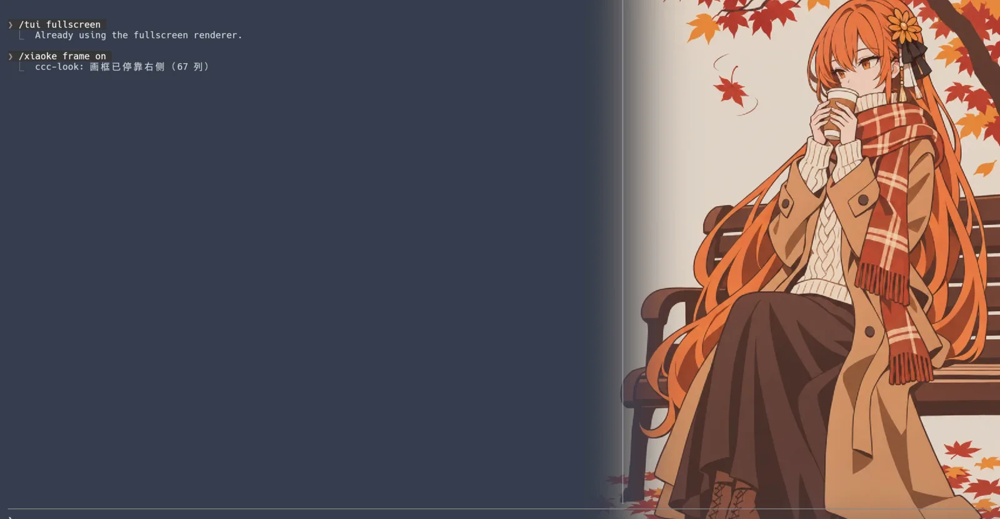

# ccc-look · 小克 (Claude-chan) look for Claude Code CLI

Claude Code CLI 的「小克」外观：在 fullscreen TUI 的右侧停靠一张插画，可选 13 套配色，按时段/季节自动换。默认不改你的终端主题。

> 这是 [bananaeat/xiaoke-look](https://github.com/bananaeat/xiaoke-look) 的 CLI 移植。原项目是 Claude 桌面端 Code 标签页的 mod，插画、配色、角色设计和场景素材都来自原作者 **bananaeat**；Claude 娘的角色设计来自 **ZipZipPipe** 的同人设定。本仓库只增加了 Claude Code CLI 的终端集成（透明 Pane 右侧停靠、kitty 背景图、状态栏、自动排期），没有重画插画，也不声称拥有原项目。与 Anthropic 无关。

**This is a CLI port of [bananaeat/xiaoke-look](https://github.com/bananaeat/xiaoke-look). All artwork, palettes and the desktop mod are by bananaeat; the character design is ZipZipPipe's fan design. This repository only adds the terminal/CLI integration and does not claim the original work. Not affiliated with Anthropic.**



## 功能

- fullscreen TUI 下，右侧停靠 44% 宽的透明插画 Pane；聊天区保持全宽，文字不压图。
- 13 套场景：清晨、午后、咖啡店、雨天、黄昏、夜读、敲代码、侦探、樱花、烟花、红叶、初雪、圣诞。
- 自动模式：按时段、季节和日期切换；会话开着时每 10 分钟检查一次。
- 状态栏：cwd / git 分支与状态 / 模型 / 上下文占用。
- 可选：把场景配色套到 Claude Code 主题或 kitty 调色板。默认关闭，保持你自己的 dark 主题。

## 要求

- Claude Code 2.1.330 或更新（使用 mod / Pane API；已在 2.1.332 上测试）。
- kitty 0.51 或更新，并开启远程控制（用来设置窗口背景图）。
- Claude Code 的 fullscreen TUI（`/tui fullscreen`），且终端至少 110 列。半屏 / classic 布局不会开画框。

kitty.conf：

```conf
allow_remote_control socket-only
listen_on unix:/tmp/kitty-{kitty_pid}
```

改完要**重启 kitty**（这两个选项在启动时读取）。没有远程控制时，插件会关掉画框，而不是留一个空白 Pane。

## 安装

```text
/plugin marketplace add Emberzure/claude-look-cli
/plugin install ccc-look@ccc-look
```

或者本地开发：

```sh
git clone https://github.com/Emberzure/claude-look-cli.git
claude --plugin-dir ./claude-look-cli
```

安装后新开一个 kitty 窗口（让远程控制生效），进入 Claude Code：

```text
/tui fullscreen
/xiaoke frame on
```

## 用法

| 命令 | 作用 |
|---|---|
| `/xiaoke` | 列出 13 套场景和当前设置 |
| `/xiaoke 樱花` | 换场景（也认 `code`、`autumn`、`night` 等） |
| `/xiaoke auto` | 按时段/季节自动换；`/xiaoke auto off` 关闭 |
| `/xiaoke frame on` | 在右侧停靠画框（仅 fullscreen + ≥110 列） |
| `/xiaoke frame off` | 关闭画框 |
| `/xiaoke sync on` | 可选：让场景配色写入 Claude Code 主题（默认 off） |
| `/xiaoke colors on` | 可选：把场景配色套到 kitty 16 色（默认 off） |
| `/xiaoke tz +8` | 自动模式使用的时区；`auto` 跟随系统 |

画框宽度默认是终端宽度的 44%；拖动 Pane 边缘后宽度会被记住。`frame` 偏好会保存，下次 fullscreen 会话会自动恢复。

## 工作方式

- 插件 mod 打开一个 `backgroundColor: transparent` 的 Pane，占住右侧空白格。
- kitty 的窗口背景图在文字后面；`assets/docks/<scene>.webp` 把人物放在画面右侧 44%，左边和底边羽化到透明，所以只有 Pane 的空白区域会看到插画。
- 场景切换时只换背景图和状态；终端默认主题不变。

## 重新生成素材

需要 Python 3 和 ImageMagick；插画原图会下载到 `.cache/`（已 gitignore）。

```sh
sh tools/fetch_art.sh
python3 -I tools/gen_art.py      # assets/{frames,banners,backgrounds,docks}
python3 -I tools/gen_themes.py   # themes/*.json
python3 -I tools/gen_kitty.py    # kitty/*.conf
```

`assets/docks` 是按 1706×1066（当前屏幕逻辑分辨率）生成的；换显示器时改 `tools/gen_art.py` 里的 `DOCK_W/DOCK_H` 再跑。

## 致谢 / Credits

- 原项目、桌面端 mod、插画、配色和排期逻辑：[bananaeat/xiaoke-look](https://github.com/bananaeat/xiaoke-look)，作者 **bananaeat**。
- 角色设计：**ZipZipPipe** 的 Claude 娘同人设定。
- CLI 移植与终端侧功能：**Emberzure**（本仓库只加了 CLI 功能）。
- 想看桌面端原版：`/plugin install xiaoke-look --marketplace bananaeat/xiaoke-look`。
- 与 Anthropic 无关。

## 授权 / License

代码以 MIT 发布，见 [LICENSE](LICENSE)；插画、图标和 `assets/` 下的派生图来自原项目，仅限非商业使用，**不在 MIT 授权范围内**。
